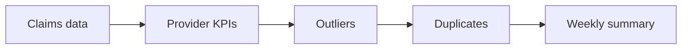

# HMO Performance System

> Turns raw claims data into the five numbers an HMO manager needs every week, and the providers to look at first.

     

**Sector:** Healthcare & Insurance  ·  **Project 29 of 50** in my [AI Automation Projects series](https://github.com/Princewill106/Princewill106)

## The problem

HMOs process thousands of claims from hundreds of hospitals. Managers can't see which providers are expensive outliers, how long approvals take, or where duplicate claims slip through, until the quarterly loss ratio arrives.

## How it works



1. **Load** — Read claims (provider, enrollee, diagnosis, amount, submitted/decided dates, status) from `sample_claims.csv`.
2. **KPIs** — Compute claims per provider, approval rate, average cost per claim and turnaround days.
3. **Outliers** — Providers whose cost per claim is far above the network average (z-score) are flagged.
4. **Duplicates** — Same enrollee + provider + diagnosis + amount within 7 days is flagged as a possible duplicate.
5. **Summarise** — A management summary with headline KPIs and actions is written to `output/hmo_summary.md`.

## Features

- Provider league table
- Approval/rejection rates and turnaround
- Cost outlier detection
- Duplicate-claim detection
- Weekly management summary

## Quick start

```bash
git clone https://github.com/Princewill106/hmo-performance-system.git
cd hmo-performance-system
python main.py --demo
```

No installs needed: it uses only the Python standard library. The demo runs fully offline using the sample data in this repo.

**Optional: plug in an LLM.** Copy `.env.example` to `.env` and add an Anthropic or OpenAI key. The project will then use the model for the language-heavy steps and fall back to its rule-based logic if a call fails.

Run the tests:

```bash
python -m unittest -v
```

## Sample output

```text
Provider                 Claims    Avg cost  Approve  TAT days
Prime Care Hospital           2     172,500     100%       5.0
Lagoon Clinic                 3      42,667      67%       2.0
Reddington Hospital           3      36,667     100%       2.0
Evercare Medical              2      32,500     100%       1.0
Mainland Health Centre        2      25,000     100%       1.0

# HMO weekly performance summary

- Claims: 12 from 5 providers, 11 enrollees
- Total claimed: NGN 698,000 (NGN 63,455 per enrollee)
- Approval rate: 90%
- Average turnaround: 2.0 days
- Pending: 2

## Actions

- Review Prime Care Hospital: cost per claim is 1.99 SD above network average
- Possible duplicate: C1003 and C1009

Saved output/hmo_summary.md
```

## Use it in n8n (no code needed)

[`n8n-workflow.json`](n8n-workflow.json) is a ready-to-import n8n version of this project, built for n8n 1.x.

1. In n8n, open **Workflows → Import from File** and choose `n8n-workflow.json`.
2. Click **Test workflow**. It runs the full logic on the sample data built into the *Sample data* node, so you can see the results before connecting anything.
3. Open each output node and connect your accounts: Gmail (OAuth2), Google Sheets (OAuth2). For Google Sheets, pick your spreadsheet and sheet.
4. Adjust the settings at the top of the **Logic** node (thresholds, templates, contacts), then **Activate**.

**Flow:** **Schedule (Mondays 7am)** → Read claims sheet → **Logic** (Code node)

**Outputs:**
- Email medical director

The Logic node is a JavaScript port of the rules in `main.py`, so you can run the project in n8n without Python.

## Use it on your own data

Export claims to CSV with the columns in `sample_claims.csv` and run `python main.py`. Tune `Z_THRESHOLD` and the duplicate window in `main.py`.

## Project structure

```text
n8n-workflow.json            Importable n8n workflow
.env.example                 Optional API key settings
.gitignore                   Git ignore rules
LICENSE                      MIT license
README.md                    This file
llm.py                       Optional LLM helper (offline fallback)
main.py                      Entry point and core logic
requirements.txt             Dependencies (stdlib only)
sample_claims.csv            Sample input data for the demo
test_main.py                 Unit tests
```

## Who this is for

- HMO claims and medical teams
- Hospital billing departments
- Health-data analytics learners

## Ideas to extend it

- [ ] Diagnosis-adjusted cost comparison
- [ ] Power BI export
- [ ] Automatic provider query letters
- [ ] Fraud scoring per claim

## About

Built by **Ogbu Ugochukwu Princewill**, AI Automation Lead and robotics engineer. I teach people and businesses to build with AI, not just talk about it. [LinkedIn](https://www.linkedin.com/in/ugochukwu-ogbu-653a0816a)

If this helped you, give it a ⭐ and share what you built with it.

## License

MIT — see [LICENSE](LICENSE).
